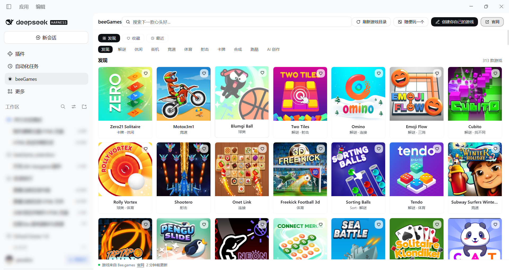

<p align="center"></p>

# beeGames

在 DeepSeek Harness 中浏览和游玩 Bee.games 的小游戏，等任务时玩一局，有消息时随时回到会话。

[Bee.games 官网](https://bee.games/) · [制作自己的游戏](https://studio.bee.games/) · [下载安装包](#安装到-deepseek-harness)



## 功能

- 浏览分类、搜索游戏，收藏喜欢的游戏，查看最近游玩。
- 暂离或切换会话时保留游戏，返回后继续；支持可拖动、可缩放的小窗。
- HUD 显示任务动态：待决定事项持续提醒，完成记录保留至点击；暂离后仍可查看。
- 中英文跟随 Harness 切换，记住本机的收藏、小窗尺寸和 HUD 位置。

## 安装到 DeepSeek Harness

打开 **插件 → 添加插件**，粘贴以下安装源并点击安装。两个源内容相同，国内网络优先用 Gitee；GitHub 超时或失败时换 Gitee 即可：

```text
https://gitee.com/wanxi-fou/dsh_beeGames/releases/download/v0.3.1/dsh-beegame-0.3.1.tgz
```

```text
https://github.com/1parado/dsh_beeGames/releases/download/v0.3.1/dsh-beegame-0.3.1.tgz
```

也可以在支持插件管理的会话（标准或创造模式）中发送以下内容，让 Harness 完成安装（`target` 换成上面任一安装源）：

```text
请调用 plugin_manager 安装并启用 beeGames，参数如下：
{
  "action": "install_bundle",
  "target": "https://gitee.com/wanxi-fou/dsh_beeGames/releases/download/v0.3.1/dsh-beegame-0.3.1.tgz",
  "enabled": true
}
```

按 Harness 提示确认安装；如提示需要重启，重启后即可在侧栏找到 **beeGames**。安装包已包含构建产物，无需手动配置端口、API Key 或构建前端。

## 使用

点击游戏封面开始游玩。点击「暂离，去会话」处理任务，再用「返回游戏」继续；最小化后可拖动标题移动窗口、拖动边缘调整大小。HUD 胶囊短按展开列表，拖动可移动位置。

游戏资源需要联网。暂离会保留游戏实例，实际暂停需要游戏支持；刷新应用、重开或结束游戏会重建或关闭当前游戏。

## 开发

需要 Node.js 20 或更高版本：

```sh
npm ci
npm run build
npm run check
npm run package:check
```

修改 `src/`、`icon.svg` 或 `locale/*.json` 后执行构建；`client.js` 是自动生成的发布文件。游戏内容由 [Bee.games](https://bee.games/) 提供，本项目为第三方 Harness 插件。
